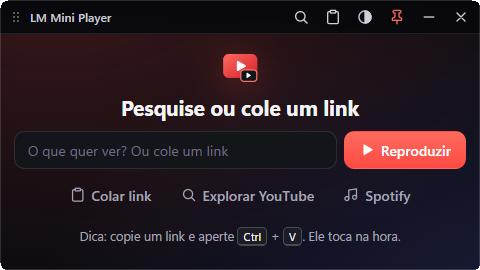
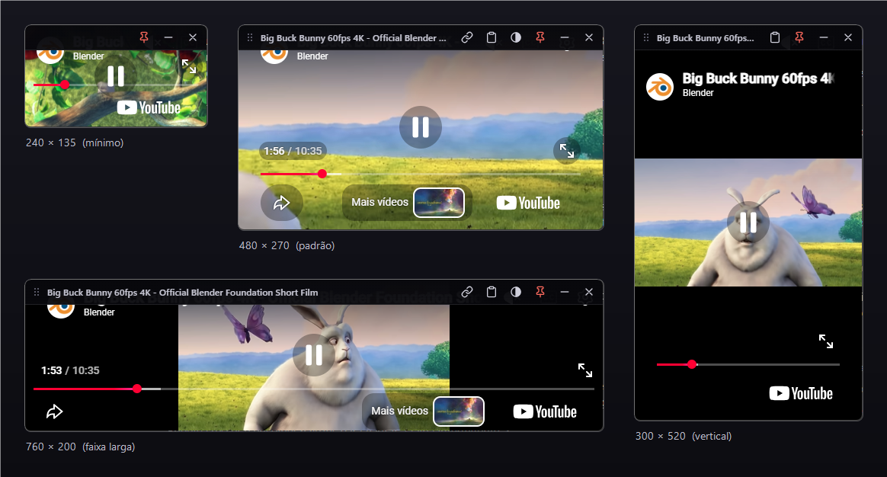
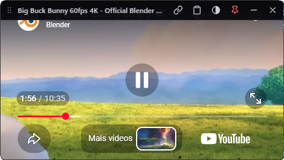

# LM Mini Player

Mini player de YouTube para Windows que fica **por cima de tudo**. Cole o link, arraste para onde quiser e deixe do tamanho que preferir: a interface se adapta a qualquer tamanho de janela, do minúsculo ao enorme. Dá para **pesquisar no YouTube aqui dentro** (sem abrir o navegador) e ouvir o **Spotify** como módulo extra.





## Baixar e usar

Para quem só quer usar (não precisa instalar nada, nem compilar):

1. Baixe o arquivo `.zip` na página de [**Releases**](https://github.com/mekea-dev/lm-mini-player/releases/latest) (em *Assets*).
2. Clique com o botão direito no `.zip` → **Propriedades** → marque **Desbloquear** → **OK**. Depois **Extrair tudo**.
3. Abra `LMMiniPlayer.exe`.

Pronto. O programa é "portátil": a pasta pode ficar em qualquer lugar. Para ter um atalho, clique com o botão direito no `LMMiniPlayer.exe` → *Fixar na barra de tarefas* (ou *Enviar para → Área de trabalho*).

**Se o Windows mostrar "O Windows protegeu o computador"** (SmartScreen): clique em *Mais informações* → *Executar assim mesmo*. Isso acontece porque o programa não tem assinatura digital paga. O código está todo neste repositório, e você pode [compilar você mesmo](#compilar).

**Requisitos:** Windows 10 ou 11 (64 bits), com o *WebView2 Runtime* da Microsoft. Ele já vem no Windows 11 e na maioria dos Windows 10 atualizados; se faltar, o programa avisa e abre a página de download. Testado no Windows 11.

## Como usar

| Quero... | Faça |
|---|---|
| Tocar um vídeo | Copie o link e abra o programa (se já houver um link do YouTube copiado, ele toca direto). Ou, com a janela em foco, aperte **Ctrl+V** |
| Trocar de vídeo | **Ctrl+V** de novo, o botão de colar da barra, ou **Ctrl+L** para pesquisar ou digitar o link |
| Pesquisar no YouTube | **Ctrl+L** (ou o botão da lupa), digite o que procura e **Enter**: os resultados do YouTube aparecem dentro do programa e, ao clicar num vídeo, ele toca no player (com a velocidade livre e tudo mais). Link colado no campo toca direto. **Explorar YouTube** abre a página inicial do site |
| Ouvir Spotify | Botão **Spotify** na tela de pesquisa (ou a aba **Spotify** na barra do modo navegação). Entre na sua conta uma vez: suas playlists e músicas curtidas aparecem. Ele continua tocando quando você volta ao player |
| Mover | Arraste pela **barra** no canto de cima (ela aparece quando o mouse mexe sobre a janela; arrasta de qualquer ponto dela, menos dos botões) |
| Redimensionar | Arraste **qualquer borda ou canto** (tamanho mínimo 240 × 135) |
| Mudar a velocidade | **D** acelera e **S** desacelera (0,1× por toque; com **Shift**, 1×). **R** volta a 1× e, apertando de novo, à velocidade anterior. Vai de **0,07× a 16×** e fica lembrada. O selo na barra mostra o valor (clique nele para voltar a 1×) |
| Voltar / avançar 10 s | **Z** / **X** |
| Legendas, mudo, qualidade | Os botões do próprio YouTube, no **canto superior direito** (a barra do programa fica à esquerda para não cobri-los). Com o foco no vídeo, **C** liga e desliga as legendas |
| Ver através da janela | Botão de **transparência** (100% → 85% → 70% → 55% → 40%) |
| Deixar de ficar por cima | Botão de **alfinete** (vem ligado) |
| Tela cheia | Botão de tela cheia do próprio YouTube; **Esc** volta ao tamanho de antes |
| Minimizar / fechar | Botões da barra |



- Aceita `youtube.com/watch?v=…`, `youtu.be/…`, `/shorts/…`, `/live/…`, `/embed/…`, playlists (`list=…`) e tempo inicial (`t=1m30s`). Pode colar o link no meio de um texto: o programa acha sozinho.
- Também dá para abrir direto de um atalho ou do terminal: `LMMiniPlayer.exe "https://youtu.be/…"`.
- Posição, tamanho, transparência e "sempre por cima" são lembrados para a próxima vez.
- Abrir o programa de novo cria **outra janela** (dá para assistir a dois vídeos).
- O **Spotify** é o player web do próprio Spotify dentro do programa. Funciona com conta gratuita (com anúncios) ou Premium. O programa não vê nem guarda a sua senha. Se o Spotify recusar o login por Google ou Facebook dentro do programa, entre com e-mail e senha.
- O YouTube e o Spotify tocam ao mesmo tempo se você deixar os dois tocando: pause um deles. Os atalhos de velocidade (D, S, R, X, Z) valem só para o YouTube.
- Para o Spotify (ou os resultados do YouTube) ficar maior, é só aumentar a janela: o site ocupa tudo abaixo da barra.
- O **Ctrl+V e as teclas de velocidade valem quando a janela do mini player está em foco** (clique nela uma vez). Não são atalhos globais.

## O que ele não faz

- **Alguns vídeos não tocam fora do YouTube** (o dono bloqueou a reprodução incorporada, restrição de idade etc.). O programa avisa e oferece o botão *Abrir no YouTube*.
- **Jogos e programas em tela cheia "exclusiva"** não deixam nenhuma janela por cima. É uma regra do Windows. Em modo "janela sem bordas" funciona normalmente.
- **Os anúncios do YouTube aparecem** como em qualquer lugar: o programa usa o player oficial incorporado e não mexe nisso.
- O YouTube recomenda janelas de pelo menos 200 × 200 px para o player incorporado. Menor que isso funciona, mas os controles ficam apertados.
- Mover e redimensionar foram feitos para **mouse**.

## Privacidade

- Nenhuma conta, nenhum cadastro, nenhuma telemetria. O programa só conversa com o YouTube (player oficial e pesquisa) e, se você abrir o módulo, com o Spotify.
- Se você entrar na sua conta do YouTube ou do Spotify dentro do programa, o login fica no perfil local do programa (veja abaixo), como num navegador. O programa não guarda senhas.
- Ao abrir **sem** link, ele olha a área de transferência uma vez para ver se há um link do YouTube. Nada é guardado nem enviado.
- Os dados locais ficam em `%LOCALAPPDATA%\LMMiniPlayer`: `config.ini` (posição e tamanho), `erro.log` (só se algo der errado) e a pasta `WebView2` (cookies e preferências do YouTube, como o volume). Para voltar ao estado de fábrica, feche o programa e apague essa pasta.

## Problemas comuns

- **Windows bloqueou o programa:** veja a nota do SmartScreen acima e use *Desbloquear* no `.zip` antes de extrair.
- **Mensagem pedindo o WebView2:** instale o *WebView2 Runtime* em <https://developer.microsoft.com/microsoft-edge/webview2/> e abra de novo.
- **O vídeo mostra um aviso de erro:** use *Abrir no YouTube*; o vídeo provavelmente não permite reprodução incorporada.
- **Algo deu errado:** o detalhe técnico fica em `%LOCALAPPDATA%\LMMiniPlayer\erro.log`.

## Como funciona

A janela é um programa nativo em C# (WinForms), sem borda e com a propriedade *sempre por cima* do Windows. O conteúdo (a tela de link, a barra e o vídeo) é uma página HTML local, exibida pelo **WebView2** (o motor do Edge que já vem no Windows), com o **player oficial do YouTube** (*IFrame Player API*). Por isso a interface é responsiva de verdade: o layout reage ao tamanho da janela com CSS, e o programa só cuida do que uma página não consegue (ficar por cima, mover/redimensionar sem borda, transparência, tela cheia, lembrar a posição, Ctrl+V com o foco dentro do vídeo).

O player oficial do YouTube só aceita de 0,25× a 2×. Para ir de 0,07× a 16× (como o *Video Speed Controller*), o programa injeta um pequeno script, `web/speed-frame.js`, dentro do player; ele mexe direto no `<video>` e só age no player incorporado do YouTube.

A pesquisa do YouTube e o Spotify são **módulos**: cada um abre o site correspondente numa segunda janela do WebView2, criada só quando você usa, que fica por baixo da barra do programa. Na pesquisa, um script (`web/yt-browse.js`) captura o clique num vídeo e manda o link para o seu player em vez de deixar o site tocar. O Spotify é o player web dele (o WebView2 tem a DRM Widevine que ele exige).

```
lm-mini-player/
├─ src/        Program.cs (a janela), manifesto e ícone
├─ web/        a interface: index.html, app.css, app.js, link.js (leitor de links), speed-frame.js (velocidade dentro do player) e yt-browse.js (cliques da pesquisa)
├─ tests/      links.html: testes do leitor de links
├─ docs/       imagens deste README
├─ build.ps1   compila (e empacota com -Package)
├─ CHANGELOG.md  o que mudou em cada versão (vira as notas do release)
└─ LICENSE
```

## Compilar

Só precisa do Windows (usa o compilador C# que já vem nele). O `build.ps1` baixa o pacote oficial `Microsoft.Web.WebView2` do NuGet (versão fixa), confere a assinatura digital da Microsoft e compila.

```powershell
powershell -ExecutionPolicy Bypass -File .\build.ps1            # gera LMMiniPlayer.exe
powershell -ExecutionPolicy Bypass -File .\build.ps1 -Package   # e também o .zip em dist\
```

**Publicar uma versão nova:** atualize `$version` em `build.ps1` e `AssemblyVersion` em `src/Program.cs`, acrescente a seção da versão no `CHANGELOG.md`, faça o commit e envie uma tag (`git tag -a v1.1.1 -m "..." && git push origin v1.1.1`). O workflow `.github/workflows/release.yml` compila no GitHub e publica o `.zip` na aba *Releases*, com o histórico da versão e o SHA-256 nas notas.

**Testes do leitor de links:** na pasta do projeto, rode `python -m http.server 8000` e abra <http://localhost:8000/tests/links.html> (mostra "OK 43/43" no título).

## Créditos e avisos

- Este projeto **não é afiliado, patrocinado nem endossado** pelo YouTube ou pelo Google. YouTube é marca registrada do Google LLC. Ao assistir vídeos, valem os [Termos de Serviço do YouTube](https://www.youtube.com/t/terms).
- *WebView2* © Microsoft. A licença acompanha o `.zip` na pasta `THIRD-PARTY`.
- Os quadros de vídeo das imagens deste README são de *Big Buck Bunny* © 2008 Blender Foundation, [CC BY 3.0](https://creativecommons.org/licenses/by/3.0/) · [bigbuckbunny.org](https://peach.blender.org/).
- Licença do código: [MIT](LICENSE).
